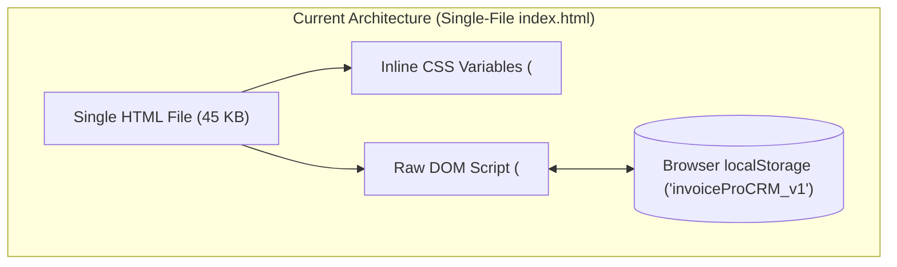
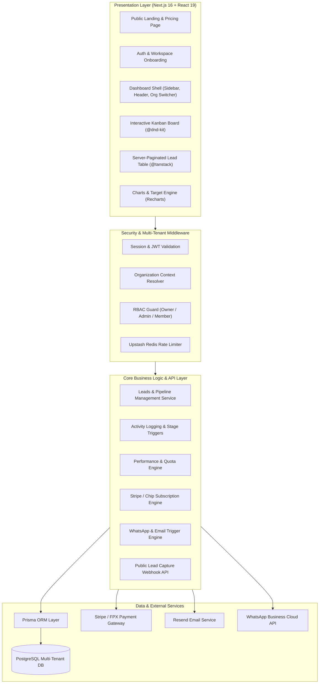
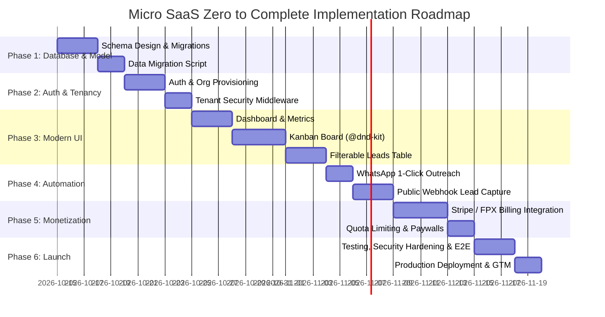
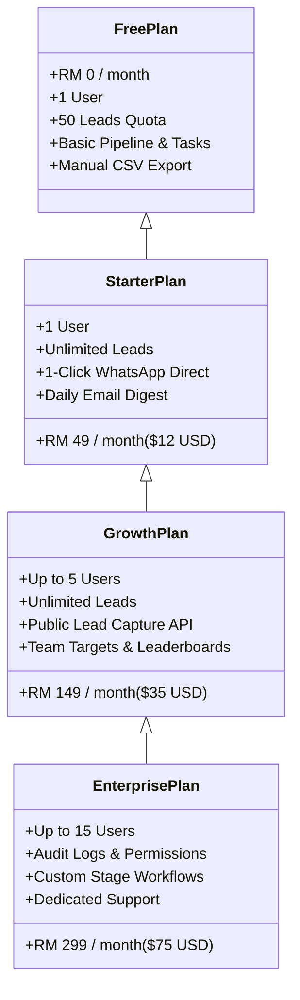

# INVOICE PRO CRM: ZERO TO COMPLETE MICRO SAAS BLUEPRINT
> **Comprehensive Phase-by-Phase Technical & Product Execution Guide**  
> *Transforming a Single-File Browser Application ([index.html](file://./index.html)) into a Commercial Multi-Tenant B2B SaaS Product.*

---

## 1. Executive Summary & Codebase Audit

### 1.1 Existing Prototype Audit
The baseline application is a standalone, single-file HTML document ([index.html](file://./index.html), 45 KB) in this working directory, designed for sales pipeline tracking and SME acquisition. 



#### Core Existing Capabilities
- **Lead Management**: Tracks business name, contact, industry, city, phone/WhatsApp, email, source, pipeline stage (10 distinct stages), priority, ICP score (0–10), expected MRR, next action, and due date.
- **Sales Activity Log**: Chronological log of outreach events (calls, meetings, demos, offers, payments).
- **KPI Metrics**: Dynamic computation of active pipeline, overdue/due follow-ups, won deals, and total Monthly Recurring Revenue (MRR).
- **Target Tracking**: Daily and weekly quota tracking against real-time actuals.
- **Data Persistence**: 100% client-side via `localStorage.getItem('invoiceProCRM_v1')`.
- **Import/Export**: JSON backup download/restore and CSV export.

#### Critical Gaps to Reach Commercial Micro SaaS
1. **Zero Multi-Tenancy**: All data belongs to whichever browser opened the file. No organization, workspace, or team concept.
2. **No Cloud Persistence**: Data is wiped if the user clears browser history or changes devices.
3. **No Authentication & Access Control**: No secure login, password reset, or Role-Based Access Control (RBAC).
4. **No Real Monetization / Billing**: Tracks MRR as a passive integer; cannot collect payments, manage subscriptions, or gate features.
5. **Passive Communications**: Phone and WhatsApp fields are plain text strings; no automated triggers, click-to-chat links, or webhook listeners.
6. **No Automated Ingestion**: Inbound leads cannot automatically flow into the CRM from website forms or ad campaigns.

---

## 2. Complete Micro SaaS System Architecture



---

## 3. Recommended Production Tech Stack

| Layer | Recommended Technology | Why Chosen for this Micro SaaS |
|---|---|---|
| **Framework** | **Next.js 16 (App Router)** | Full-stack React 19 framework; unified API routes, Server Actions, SEO-friendly landing page, and zero-config deployment. |
| **Language** | **TypeScript 5.x** | End-to-end type safety from database schema to frontend components. |
| **Styling & UI** | **Tailwind CSS v4 + Radix UI / shadcn/ui** | Matches modern enterprise design system tokens; accessible primitives. |
| **Database** | **PostgreSQL** | Relational integrity, ACID compliance, native JSONB support, powerful indexing. |
| **ORM** | **Prisma 6.x** | Declarative schema, automated migrations, type-safe client with relation filtering. |
| **Authentication** | **Supabase Auth or Clerk** | Out-of-the-box multi-tenancy (Organizations), social logins, session management, and RBAC. |
| **State & Data Fetching** | **TanStack Query v5 + Server Actions** | Optimistic UI updates for drag-and-drop Kanban; efficient caching and invalidation. |
| **Drag & Drop** | **@dnd-kit/core** | Modern, accessible, fluid drag-and-drop for multi-column pipeline boards. |
| **Payments & Billing** | **Stripe Billing (Global) + Chip / Curlec (Malaysia FPX)** | Subscription lifecycle, customer portal, automated webhooks, invoice generation. |
| **Email & Messaging** | **Resend + WhatsApp Cloud API** | Fast transactional email delivery and 1-click WhatsApp messaging for SMB leads. |
| **Hosting & Infra** | **Vercel / Railway + Supabase / Neon Postgres** | Serverless scaling, managed database with automated daily backups. |

---

## 4. Phase-by-Phase Execution Roadmap



---

### PHASE 1: Relational Data Modeling & PostgreSQL Migration

#### 1.1 Multi-Tenant Database Schema (`prisma/schema.prisma`)
The core foundation requires transforming the flat JavaScript objects into relational entities enforcing tenant boundaries.

```prisma
datasource db {
  provider = "postgresql"
  url      = env("DATABASE_URL")
}

generator client {
  provider = "prisma-client-js"
}

enum Role {
  OWNER
  ADMIN
  SALES_REP
  VIEWER
}

enum LeadPriority {
  HIGH
  MEDIUM
  LOW
}

enum DealStatus {
  OPEN
  WON_PAID
  LOST
  NURTURE
}

enum SubscriptionTier {
  FREE
  STARTER
  GROWTH
  ENTERPRISE
}

enum SubscriptionStatus {
  TRIALING
  ACTIVE
  PAST_DUE
  CANCELED
}

model Organization {
  id              String         @id @default(cuid())
  name            String
  slug            String         @unique
  currency        String         @default("MYR")
  createdAt       DateTime       @default(now())
  updatedAt       DateTime       @updatedAt

  memberships     Membership[]
  leads           Lead[]
  activities      Activity[]
  targets         Target[]
  subscription    Subscription?
  apiKeys         ApiKey[]
  leadCaptureForm LeadCaptureForm?

  @@index([slug])
}

model User {
  id              String         @id @default(cuid())
  email           String         @unique
  name            String?
  avatarUrl       String?
  phone           String?
  createdAt       DateTime       @default(now())
  updatedAt       DateTime       @updatedAt

  memberships     Membership[]
  assignedLeads   Lead[]         @relation("AssignedLeads")
  loggedActivities Activity[]    @relation("UserActivities")
}

model Membership {
  id              String         @id @default(cuid())
  role            Role           @default(SALES_REP)
  organizationId  String
  userId          String
  createdAt       DateTime       @default(now())

  organization    Organization   @relation(fields: [organizationId], references: [id], onDelete: Cascade)
  user            User           @relation(fields: [userId], references: [id], onDelete: Cascade)

  @@unique([organizationId, userId])
  @@index([userId])
}

model Lead {
  id              String         @id @default(cuid())
  organizationId  String
  assignedToId    String?
  company         String
  contact         String?
  industry        String
  city            String?
  phone           String?
  email           String?
  website         String?
  source          String         @default("Google Maps")
  stage           String         @default("New Lead")
  priority        LeadPriority   @default(MEDIUM)
  score           Int            @default(5)
  mrr             Decimal        @default(0.0) @db.Decimal(10, 2)
  lastContact     DateTime?
  nextAction      String         @default("First outreach")
  dueDate         DateTime?
  closeDate       DateTime?
  pain            String?
  dealStatus      DealStatus     @default(OPEN)
  notes           String?        @db.Text
  lossReason      String?
  wonDate         DateTime?
  onboarded       Boolean        @default(false)
  createdAt       DateTime       @default(now())
  updatedAt       DateTime       @updatedAt

  organization    Organization   @relation(fields: [organizationId], references: [id], onDelete: Cascade)
  assignedTo      User?          @relation("AssignedLeads", fields: [assignedToId], references: [id], onDelete: SetNull)
  activities      Activity[]

  @@index([organizationId, stage])
  @@index([organizationId, dueDate])
  @@index([organizationId, dealStatus])
}

model Activity {
  id              String         @id @default(cuid())
  organizationId  String
  leadId          String
  userId          String?
  type            String
  notes           String         @db.Text
  nextAction      String?
  createdAt       DateTime       @default(now())

  organization    Organization   @relation(fields: [organizationId], references: [id], onDelete: Cascade)
  lead            Lead           @relation(fields: [leadId], references: [id], onDelete: Cascade)
  user            User?          @relation("UserActivities", fields: [userId], references: [id], onDelete: SetNull)

  @@index([organizationId, leadId])
  @@index([organizationId, createdAt])
}

model Target {
  id              String         @id @default(cuid())
  organizationId  String
  period          String         // "daily" or "weekly"
  prospects       Int            @default(10)
  outreach        Int            @default(10)
  followups       Int            @default(3)
  positive        Int            @default(2)
  meetings        Int            @default(1)
  demos           Int            @default(1)
  paid            Int            @default(0)
  updatedAt       DateTime       @updatedAt

  organization    Organization   @relation(fields: [organizationId], references: [id], onDelete: Cascade)

  @@unique([organizationId, period])
}

model Subscription {
  id                   String             @id @default(cuid())
  organizationId       String             @unique
  stripeCustomerId     String?            @unique
  stripeSubscriptionId String?            @unique
  tier                 SubscriptionTier   @default(FREE)
  status               SubscriptionStatus @default(ACTIVE)
  currentPeriodEnd     DateTime?
  leadQuotaLimit       Int                @default(50)
  userQuotaLimit       Int                @default(1)
  createdAt            DateTime           @default(now())
  updatedAt            DateTime           @updatedAt

  organization         Organization       @relation(fields: [organizationId], references: [id], onDelete: Cascade)
}

model ApiKey {
  id              String         @id @default(cuid())
  organizationId  String
  name            String
  keyHash         String         @unique
  lastUsedAt      DateTime?
  createdAt       DateTime       @default(now())

  organization    Organization   @relation(fields: [organizationId], references: [id], onDelete: Cascade)
}

model LeadCaptureForm {
  id              String         @id @default(cuid())
  organizationId  String         @unique
  title           String         @default("Contact Our Sales Team")
  defaultIndustry String         @default("Retail / shop")
  defaultSource   String         @default("Website Inbound")
  isActive        Boolean        @default(true)
  createdAt       DateTime       @default(now())

  organization    Organization   @relation(fields: [organizationId], references: [id], onDelete: Cascade)
}
```

#### 1.2 Data Migration Tool (`scripts/migrate-local-backup.ts`)
To ensure smooth migration for current users of the single-file application, build a migration parser that maps JSON exports into PostgreSQL:

```typescript
import { PrismaClient, LeadPriority, DealStatus } from '@prisma/client';
import fs from 'fs';

const prisma = new PrismaClient();

export async function importSingleFileBackup(filePath: string, organizationId: string, userId: string) {
  const rawData = JSON.parse(fs.readFileSync(filePath, 'utf-8'));
  const { leads, activities, targets } = rawData;

  console.log(`Importing ${leads.length} leads and ${activities.length} activities...`);

  // Map and import leads
  const leadIdMapping = new Map<string, string>();

  for (const l of leads) {
    const priorityMap: Record<string, LeadPriority> = {
      'High': LeadPriority.HIGH,
      'Medium': LeadPriority.MEDIUM,
      'Low': LeadPriority.LOW,
    };

    const statusMap: Record<string, DealStatus> = {
      'Open': DealStatus.OPEN,
      'Won — Paid': DealStatus.WON_PAID,
      'Lost': DealStatus.LOST,
      'Nurture': DealStatus.NURTURE,
    };

    const createdLead = await prisma.lead.create({
      data: {
        organizationId,
        assignedToId: userId,
        company: l.company,
        contact: l.contact || null,
        industry: l.industry || 'Other SMB',
        city: l.city || null,
        phone: l.phone || null,
        email: l.email || null,
        website: l.website || null,
        source: l.source || 'Imported Backup',
        stage: l.stage || 'New Lead',
        priority: priorityMap[l.priority] || LeadPriority.MEDIUM,
        score: Number(l.score) || 5,
        mrr: Number(l.mrr) || 0,
        lastContact: l.lastContact ? new Date(l.lastContact) : null,
        nextAction: l.nextAction || 'First outreach',
        dueDate: l.dueDate ? new Date(l.dueDate) : null,
        closeDate: l.closeDate ? new Date(l.closeDate) : null,
        pain: l.pain || null,
        dealStatus: statusMap[l.dealStatus] || DealStatus.OPEN,
        notes: l.notes || null,
        lossReason: l.lossReason || null,
        wonDate: l.wonDate ? new Date(l.wonDate) : null,
        createdAt: l.createdAt ? new Date(l.createdAt) : new Date(),
      },
    });

    leadIdMapping.set(l.id, createdLead.id);
  }

  // Map and import activities
  for (const a of activities) {
    const cloudLeadId = leadIdMapping.get(a.leadId);
    if (!cloudLeadId) continue;

    await prisma.activity.create({
      data: {
        organizationId,
        leadId: cloudLeadId,
        userId,
        type: a.type,
        notes: a.notes,
        nextAction: a.next || null,
        createdAt: a.date ? new Date(a.date) : new Date(),
      },
    });
  }

  console.log('Migration completed successfully.');
}
```

---

### PHASE 2: Authentication, Tenant Scoping & Security Middleware

#### 2.1 Multi-Tenant Context Resolver
In Next.js 16 App Router, every data mutation and query must be strictly scoped to the active tenant.

```typescript
// src/lib/auth-context.ts
import { auth } from '@clerk/nextjs/server'; // or Supabase session
import { prisma } from '@/lib/prisma';
import { redirect } from 'next/navigation';

export async function getTenantContext() {
  const { userId } = await auth();
  if (!userId) {
    redirect('/login');
  }

  // Find user's active membership
  const membership = await prisma.membership.findFirst({
    where: { userId },
    include: {
      organization: {
        include: { subscription: true }
      },
      user: true,
    },
  });

  if (!membership) {
    redirect('/onboarding');
  }

  return {
    userId: membership.userId,
    user: membership.user,
    organizationId: membership.organizationId,
    organization: membership.organization,
    role: membership.role,
    subscription: membership.organization.subscription,
  };
}
```

#### 2.2 Role-Based Access Control (RBAC) Matrix

| Permission | Owner | Admin | Sales Rep | Viewer |
|---|:---:|:---:|:---:|:---:|
| View Pipeline & Leads | Yes | Yes | Yes | Yes |
| Create / Edit Leads | Yes | Yes | Yes | No |
| Log Outreach Activities | Yes | Yes | Yes | No |
| Delete Leads | Yes | Yes | No | No |
| Edit Targets & Quotas | Yes | Yes | No | No |
| Invite / Remove Team Members | Yes | Yes | No | No |
| Manage Billing & Subscriptions | Yes | No | No | No |
| Access Public API Keys | Yes | Yes | No | No |

---

### PHASE 3: Frontend Modernization & Component Architecture

#### 3.1 Next.js 16 App Router Structure
```
src/
├── app/
│   ├── (marketing)/
│   │   ├── page.tsx               # Hero, Value Prop, Pricing, Testimonials
│   │   └── pricing/page.tsx       # Tier breakdown & FAQ
│   ├── (auth)/
│   │   ├── login/page.tsx
│   │   ├── register/page.tsx
│   │   └── onboarding/page.tsx    # Organization name & currency setup
│   ├── (dashboard)/
│   │   ├── layout.tsx             # Shell: Sidebar, Mobile Drawer, Header
│   │   ├── dashboard/page.tsx     # KPI metrics, Today's action feed
│   │   ├── pipeline/page.tsx      # Drag-and-drop Kanban board
│   │   ├── leads/page.tsx         # Data table, search, multi-filter
│   │   ├── tasks/page.tsx         # Overdue and due today follow-up queue
│   │   ├── activities/page.tsx    # Activity timeline & audits
│   │   ├── targets/page.tsx       # Quotas vs. actuals performance bars
│   │   └── settings/
│   │       ├── general/page.tsx
│   │       ├── team/page.tsx      # Member invitations & roles
│   │       ├── billing/page.tsx   # Stripe Customer Portal embed
│   │       └── import/page.tsx    # JSON / CSV importer
│   └── api/
│       ├── v1/leads/capture/route.ts
│       └── webhooks/stripe/route.ts
├── components/
│   ├── kanban/
│   │   ├── board.tsx
│   │   ├── column.tsx
│   │   └── lead-card.tsx
│   ├── leads/
│   │   ├── lead-modal.tsx
│   │   ├── quick-activity-modal.tsx
│   │   └── whatsapp-button.tsx
│   └── dashboard/
│       ├── kpi-stat-card.tsx
│       └── target-progress-bar.tsx
```

#### 3.2 Drag-and-Drop Kanban Board Component (`components/kanban/board.tsx`)
Transform the static stage dropdown into an interactive, real-time board:

```tsx
'use client';

import React, { useState } from 'react';
import { DndContext, DragEndEvent, closestCorners } from '@dnd-kit/core';
import { KanbanColumn } from './column';
import { updateLeadStageAction } from '@/actions/leads';
import { toast } from 'sonner';

const STAGES = [
  'New Lead', 'Qualified', 'Contacted', 'Engaged', 
  'Meeting Booked', 'Demo Completed', 'Offer Sent', 
  'Negotiation / Decision', 'Won — Paid', 'Lost / Nurture'
];

export function KanbanBoard({ initialLeads }: { initialLeads: any[] }) {
  const [leads, setLeads] = useState(initialLeads);

  async function handleDragEnd(event: DragEndEvent) {
    const { active, over } = event;
    if (!over) return;

    const leadId = active.id as string;
    const newStage = over.id as string;

    const currentLead = leads.find(l => l.id === leadId);
    if (!currentLead || currentLead.stage === newStage) return;

    // Optimistic UI Update
    setLeads(prev => prev.map(l => l.id === leadId ? { ...l, stage: newStage } : l));

    try {
      await updateLeadStageAction(leadId, newStage);
      toast.success(`Moved ${currentLead.company} to ${newStage}`);
    } catch (err) {
      // Revert on error
      setLeads(initialLeads);
      toast.error('Failed to update pipeline stage.');
    }
  }

  return (
    <DndContext collisionDetection={closestCorners} onDragEnd={handleDragEnd}>
      <div className="flex gap-4 overflow-x-auto pb-6">
        {STAGES.map(stage => (
          <KanbanColumn
            key={stage}
            id={stage}
            title={stage}
            leads={leads.filter(l => l.stage === stage)}
          />
        ))}
      </div>
    </DndContext>
  );
}
```

---

### PHASE 4: Sales Automation & Inbound Integrations

#### 4.1 Smart 1-Click WhatsApp Direct Action (`components/leads/whatsapp-button.tsx`)
In Malaysia and Southeast Asia, WhatsApp is the primary medium for SMB sales. Modernize plain phone strings into intelligent one-tap outreach triggers:

```tsx
'use client';

import { MessageSquare } from 'lucide-react';
import { Button } from '@/components/ui/button';

export function WhatsAppOutreachButton({ lead }: { lead: { phone?: string | null; company: string; contact?: string | null } }) {
  if (!lead.phone) return null;

  // Clean and format phone number to international standard (defaulting to +60 for Malaysia)
  let cleanPhone = lead.phone.replace(/[^0-9]/g, '');
  if (cleanPhone.startsWith('0')) {
    cleanPhone = '60' + cleanPhone.slice(1);
  }

  const message = encodeURIComponent(
    `Hello ${lead.contact || lead.company}, this is regarding your invoice and billing workflow at ${lead.company}. Do you have 2 minutes to connect?`
  );

  const waUrl = `https://wa.me/${cleanPhone}?text=${message}`;

  return (
    <Button
      variant="outline"
      size="sm"
      className="gap-2 text-emerald-600 border-emerald-200 hover:bg-emerald-50"
      onClick={() => window.open(waUrl, '_blank')}
    >
      <MessageSquare className="w-4 h-4" />
      WhatsApp
    </Button>
  );
}
```

#### 4.2 Inbound Public Lead Capture Webhook (`app/api/v1/leads/capture/route.ts`)
Allow subscribers to hook up their website contact forms, Typeform, or Facebook Lead Ads directly into their CRM:

```typescript
import { NextRequest, NextResponse } from 'next/server';
import { prisma } from '@/lib/prisma';
import crypto from 'crypto';

export async function POST(req: NextRequest) {
  try {
    const authHeader = req.headers.get('authorization');
    if (!authHeader?.startsWith('Bearer ')) {
      return NextResponse.json({ error: 'Missing or invalid API Key' }, { status: 401 });
    }

    const rawKey = authHeader.replace('Bearer ', '');
    const keyHash = crypto.createHash('sha256').update(rawKey).digest('hex');

    const apiKey = await prisma.apiKey.findUnique({
      where: { keyHash },
      include: { organization: { include: { subscription: true } } },
    });

    if (!apiKey) {
      return NextResponse.json({ error: 'Unauthorized' }, { status: 401 });
    }

    const { organization } = apiKey;

    // Check Quota Limit
    const currentLeadCount = await prisma.lead.count({
      where: { organizationId: organization.id },
    });

    if (currentLeadCount >= (organization.subscription?.leadQuotaLimit || 50)) {
      return NextResponse.json({ error: 'Lead quota exceeded for current subscription plan.' }, { status: 403 });
    }

    const body = await req.json();
    const { company, contact, email, phone, industry, city, pain } = body;

    if (!company) {
      return NextResponse.json({ error: 'Company name is required' }, { status: 400 });
    }

    const newLead = await prisma.lead.create({
      data: {
        organizationId: organization.id,
        company,
        contact: contact || null,
        email: email || null,
        phone: phone || null,
        industry: industry || 'Other SMB',
        city: city || null,
        pain: pain || null,
        source: 'API Inbound Webhook',
        stage: 'New Lead',
        nextAction: 'First outreach',
        dueDate: new Date(),
      },
    });

    return NextResponse.json({ success: true, leadId: newLead.id }, { status: 201 });
  } catch (error) {
    console.error('Lead capture error:', error);
    return NextResponse.json({ error: 'Internal server error' }, { status: 500 });
  }
}
```

---

### PHASE 5: SaaS Monetization, Subscriptions & Metering

#### 5.1 Pricing Strategy & Packaging



#### 5.2 Stripe Webhook Listener (`app/api/webhooks/stripe/route.ts`)
```typescript
import { NextRequest, NextResponse } from 'next/server';
import { stripe } from '@/lib/stripe';
import { prisma } from '@/lib/prisma';
import Stripe from 'stripe';

export async function POST(req: NextRequest) {
  const body = await req.text();
  const signature = req.headers.get('stripe-signature')!;

  let event: Stripe.Event;
  try {
    event = stripe.webhooks.constructEvent(body, signature, env.STRIPE_WEBHOOK_SECRET);
  } catch (err: any) {
    return NextResponse.json({ error: `Webhook signature failed: ${err.message}` }, { status: 400 });
  }

  switch (event.type) {
    case 'checkout.session.completed': {
      const session = event.data.object as Stripe.Checkout.Session;
      const organizationId = session.metadata?.organizationId;
      if (!organizationId) break;

      await prisma.subscription.upsert({
        where: { organizationId },
        update: {
          stripeCustomerId: session.customer as string,
          stripeSubscriptionId: session.subscription as string,
          tier: 'GROWTH',
          status: 'ACTIVE',
          leadQuotaLimit: 100000,
          userQuotaLimit: 5,
        },
        create: {
          organizationId,
          stripeCustomerId: session.customer as string,
          stripeSubscriptionId: session.subscription as string,
          tier: 'GROWTH',
          status: 'ACTIVE',
          leadQuotaLimit: 100000,
          userQuotaLimit: 5,
        },
      });
      break;
    }

    case 'customer.subscription.deleted': {
      const subscription = event.data.object as Stripe.Subscription;
      await prisma.subscription.updateMany({
        where: { stripeSubscriptionId: subscription.id },
        update: {
          tier: 'FREE',
          status: 'CANCELED',
          leadQuotaLimit: 50,
          userQuotaLimit: 1,
        },
      });
      break;
    }
  }

  return NextResponse.json({ received: true });
}
```

---

### PHASE 6: Production Infrastructure, Security & Launch

#### 6.1 Security Hardening Checklist
- **Tenant Isolation**: Always enforce `where: { organizationId }` on every Prisma query.
- **CSRF & Rate Limiting**: Configure Upstash Redis rate limiting on auth and capture endpoints (`10 requests / 10s`).
- **Input Validation**: Enforce strict Zod schemas on all API inputs to prevent script injection.
- **Audit Logging**: Store every stage change, lead deletion, and export action for compliance.

#### 6.2 Pre-Launch Testing Suite
1. **Automated Unit Tests**:
   - Quota check test: verify `leadQuotaLimit` prevents adding the 51st lead on the free plan.
   - Stage validation test: ensure transitions to "Won — Paid" automatically update `dealStatus` and `wonDate`.
2. **Multi-Tenant Security E2E Test**:
   - Create Org A and Org B in Playwright.
   - Verify Org B cannot access `GET /api/leads` belonging to Org A.
3. **Data Loss Prevention Test**:
   - Run `migrate-local-backup.ts` with a 500-lead test payload. Confirm 100% record match.

#### 6.3 30-Day Go-To-Market (GTM) Playbook
- **Day 1–7**: Deploy landing page with free lead tracker tool demo.
- **Day 8–14**: Reach out to 100 Malaysian SMB owners (Retail, Services, Contractors) offering free lifetime Starter accounts in exchange for feedback.
- **Day 15–21**: Launch on Product Hunt, Indie Hackers, and Malaysian tech communities (e.g., Tech in Asia, Facebook SME groups).
- **Day 22–30**: Activate Google/Facebook Ads targeting keywords: *"CRM perniagaan Malaysia"*, *"sales pipeline software SME"*, *"simple B2B CRM"*.

---

## 5. Summary of Deliverables & Next Steps

1. **Prisma Schema & Migrations**: Ready for initial migration.
2. **Migration Utility**: Imports existing local browser backups seamlessly.
3. **Multi-Tenant Framework**: Ready for Next.js App Router.
4. **Subscription Engine**: Ready for Stripe / Malaysian FPX integration.
